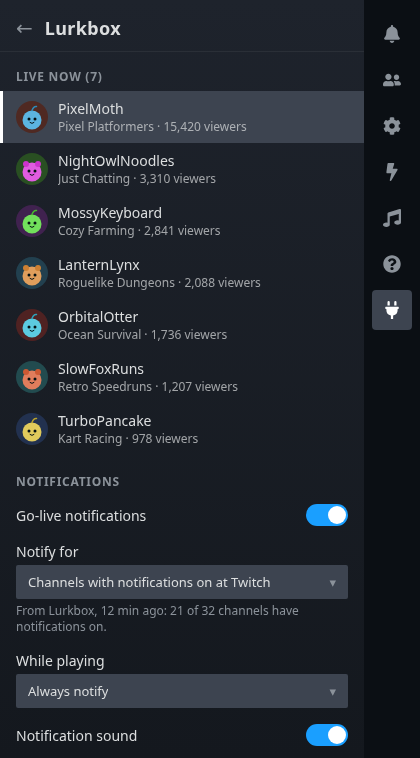
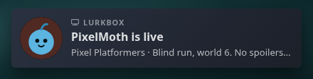

# Lurkbox for Decky

> **AI disclosure:** this plugin is vibe-coded. Claude (Anthropic's AI coding assistant) wrote nearly all of the code and docs, and it was tested by hand. Human review of the code has been limited, so expect rough edges and read it before trusting it with anything important. Bug reports welcome.

A [Decky Loader](https://github.com/SteamDeckHomebrew/decky-loader) plugin for SteamOS Game Mode that notifies you when channels you follow on Twitch go live. It works while a game is running, and it works when the Lurkbox app isn't running. Selecting a notification opens the channel in [Lurkbox](https://github.com/lurkbox), the controller-driven Twitch client.

Not affiliated with or endorsed by Twitch.

<p>
  
  
</p>

The screenshots use made-up channels; the panel frame is a look-alike of Steam's Quick Access menu (`pnpm build && pnpm screenshots`, see [Building](#building)).

## What it does

- **Go-live notifications** through Steam's own notification toasts. Each one shows "*Name* is live", the game and the stream title, and the channel's avatar. The sound is Steam's own, and **Notification sound** in the panel turns it off for these notifications only.
- **Opens the channel in Lurkbox.** Selecting a notification, or a channel under "Live now", starts Lurkbox on that channel. If Lurkbox is already running, it switches to that channel.
- **Quick Access panel** with:
  - your sign-in;
  - **Live now**: followed channels that are live, with avatar, game and viewer count;
  - a notifications on/off switch;
  - **Notify for**: *Channels with notifications on at Twitch* (default), *All followed channels*, or *Only my list*;
  - **While playing**: *Always notify* (default), *Not while Lurkbox is in front*, or *Stay quiet while a game runs*;
  - **Check**: every 30 seconds, every minute (default) or every 2 minutes;
  - **Channels**: a searchable list of your follows with an on/off switch for each one. A switch that differs from what "Notify for" says is remembered as a per-channel mute or always-notify;
  - **Test notification**.

## Install

The plugin needs Decky Loader.

**From a release zip** (recommended):

1. Download `decky-lurkbox-<version>.zip` from the GitHub releases.
2. In Game Mode, open Decky's settings (the gear in Decky's Quick Access tab) → General → turn on **Developer mode**.
3. Decky settings → Developer → **Install Plugin from ZIP File**, and pick the zip.

**By hand** (over SSH, or in Desktop Mode):

```sh
unzip decky-lurkbox-<version>.zip -d /tmp/decky-lurkbox
sudo cp -r /tmp/decky-lurkbox/Lurkbox "$HOME/homebrew/plugins/"
sudo systemctl restart plugin_loader
```

## Sign in

Open the Quick Access menu → Decky → **Lurkbox** → **Sign in with Twitch**. The panel shows a code and a QR code. On your phone, go to twitch.tv/activate (or scan the code), enter the code, and press Authorize.

- The plugin uses the Lurkbox app's public Twitch Client ID and asks only for **`user:read:follows`** (read the channels you follow).
- Its tokens are stored in Decky's settings folder for the plugin (`$DECKY_PLUGIN_SETTINGS_DIR/tokens.json`, normally `$HOME/homebrew/settings/Lurkbox/`) with mode 0600. Nothing is logged that contains a token.
- **The sign-in is separate from the Lurkbox app's.** Twitch gives each sign-in its own refresh token, so the plugin and the app refresh their tokens independently and never sign each other out. Signing out in one does not sign out the other.

## Which channels notify

### Channels with notifications on at Twitch (default)

On twitch.tv, each channel you follow has a notification bell. Twitch's public API (Helix) doesn't say which bells are on, so the Lurkbox app reads them and shares them with the plugin:

- While Lurkbox is signed in to twitch.tv (its normal sign-in), it reads the bell setting of each follow every 10 minutes and writes `$HOME/.config/Lurkbox/notify-channels.json` (`{updated_at, user_id, channels: [{id, login, notify}]}`). The Flatpak keeps its profile in `$HOME/.var/app/io.github.lurkbox.Lurkbox/config/Lurkbox/` instead; the plugin checks both and uses the one with the newer `notify-channels.json` (the AppImage's when neither has one).
- **This uses Twitch's unofficial web GQL API** (the API twitch.tv itself uses), through the Lurkbox app. The plugin itself only uses the official Helix API.
- The plugin uses the file only when it belongs to the same Twitch account the plugin is signed in with.
- **Lurkbox must have been run and signed in at least once.** Until the file exists (or when it belongs to another account), the plugin notifies for all followed channels and says so in the panel.
- A channel you followed after the last sync counts as "on", which is Twitch's default for a new follow.

**All followed channels** and **Only my list** work without the Lurkbox app and without the unofficial API.

### Per-channel choices

Under **Channels → Choose channels…**, each follow has a switch. Turning a channel off when "Notify for" would notify mutes it; turning one on when it wouldn't makes it always notify. A mute always wins. With **Only my list**, only the channels you switch on notify. **Clear the choices made here** removes them all.

## How it works

- The backend (`main.py`, logic in `py_modules/lurkbox_core.py`) polls `GET /helix/streams/followed` at the chosen interval and compares it with the previous result. A channel that wasn't live before is announced once per stream: the same stream id never notifies twice.
- The first check after Decky starts (or after you sign in) only records who is already live, so you don't get a burst of notifications at boot.
- After a 429 (rate limit) it waits until Twitch's reset time; after network or server errors it doubles the wait, up to 15 minutes. An expired token is refreshed once; if that fails, the panel asks you to sign in again.
- **Opening a channel:** the backend writes `open-request.json` into the same profile (`$HOME/.config/Lurkbox/` or the Flatpak's) (`{channel, name, at}`), and the frontend starts the Lurkbox shortcut with `SteamClient.Apps.RunGame`. It finds the shortcut by its name, **Lurkbox**, in your Steam library. Lurkbox reads the request at startup and while running, and opens the channel if the request is under 2 minutes old.
- Every backend call catches its own errors and logs them to Decky's plugin log (`$DECKY_PLUGIN_LOG_DIR`), so a failure never takes Decky down.

## Building

Requirements: Node.js, [pnpm](https://pnpm.io) and Python 3.

```sh
pnpm install
pnpm build              # dist/index.js
python3 -m unittest discover -s tests -v   # backend tests (pnpm test runs the same)
sh package.sh           # out/decky-lurkbox-<version>.zip
```

**Screenshots:** `pnpm screenshots` (after `pnpm build`) renders the built panel and a go-live toast with made-up channels into `docs/screenshots/`. It bundles `scripts/screenshots/harness.js` (React from the devDependencies, stand-ins for the `@decky/ui` pieces styled like the Quick Access menu, and a fake backend) and captures it in Electron: `ELECTRON=/path/to/electron`, or the `electron` package if Node can find it (it can inside the Lurkbox monorepo). Uses `xvfb-run` when installed, and ImageMagick to recompress the PNGs when present. Nothing is fetched.

The zip contains `Lurkbox/` with `plugin.json`, `package.json`, `main.py`, `py_modules/`, `dist/index.js`, `LICENSE`, `NOTICE-decky-plugin-template` and this README.

**Releases:** pushing a tag `v<version>` runs `.github/workflows/release.yml`. It checks that `package.json` and `plugin.json` both carry that version, runs the backend tests, builds the zip and attaches it to the GitHub release.

## License

Copyright (C) 2026 aronwk-aaron.

This program is free software: you can redistribute it and/or modify it under the terms of the **GNU General Public License, version 3 or (at your option) any later version** (GPL-3.0-or-later). It is distributed in the hope that it will be useful, but WITHOUT ANY WARRANTY; without even the implied warranty of MERCHANTABILITY or FITNESS FOR A PARTICULAR PURPOSE. See [LICENSE](LICENSE) for the full text.

`dist/index.js` bundles [qrcode-generator](https://github.com/kazuhikoarase/qrcode-generator) and [react-icons](https://github.com/react-icons/react-icons) (both MIT) and `@decky/api` (LGPL-2.1).

The build setup (`rollup.config.js`, `tsconfig.json`, `src/types.d.ts`, `decky.pyi`) comes from [decky-plugin-template](https://github.com/SteamDeckHomebrew/decky-plugin-template) under the BSD 3-Clause license; see [NOTICE-decky-plugin-template](NOTICE-decky-plugin-template).
